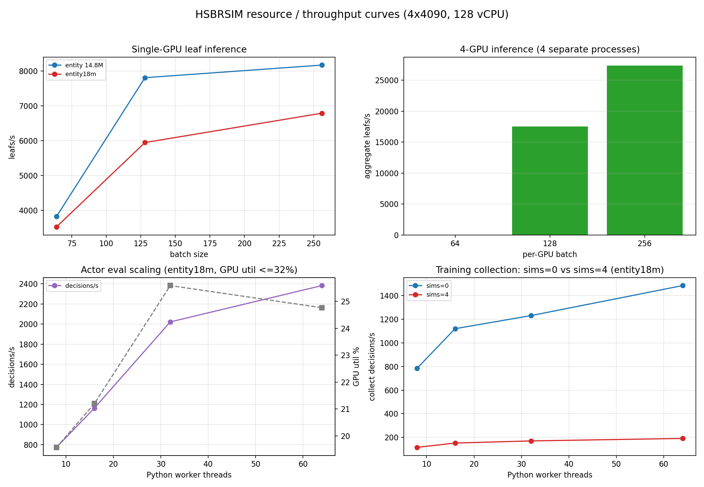

# 18M/56+1 模型与 4 GPU / 多 CPU 资源基准

> 目的：在启动 6–12h 长训练前，先记录模型结构、资源占用和吞吐/超参曲线。
> 本文件记录实测；长训练尚未启动。



## 1. 网络对齐：entity18m

新增 `arch=entity18m`：

| 项目 | entity（旧） | entity18m（新） |
|---|---:|---:|
| 参数 | 14,808,254 | **17,982,654** |
| token | 49（含 global） | **57（1 global + 56 entity）** |
| 组成 | 7 board + 10 hand + 8 shop + 16 choices + 7 opp | 同上 + **8 pending-context** |
| d_model | 384 | 384 |
| layers / heads | 8 / 8 | 8 / 8 |
| FF | 1536 | **2048** |
| pos_emb | 16 | **24** |
| type_emb | 6 | 7 |

**注意**：当前 observation 只有 16 个 choices；`entity18m` 的 8 个 pending-context token
是从 `global + pending one-hot` 派生的**结构补位**，不是新增 8 个真实观测槽位。
所以它是“18M/57 token 结构对齐”，不是“AutoTavern 原始数据布局逐位复刻”。

测试：`tests/test_entity18m.py`（参数、token、forward、checkpoint roundtrip）。

## 2. 单 GPU 前向吞吐

1024 leaves，BatchLeafServer：

| batch | entity 14.8M leaf/s | entity18m leaf/s | 18M 相对 |
|---:|---:|---:|---:|
| 64 | 3,819 | 3,522 | -7.8% |
| 128 | 7,812 | 5,947 | -23.9% |
| 256 | 8,174 | 6,791 | -16.9% |

- entity18m 前向比 14.8M 慢约 **8–24%**；
- 显存峰值：14.8M ≈ 282MB，18M ≈ **355MB**（forward benchmark）；
- 18M 仍远小于 24GB，显存不是瓶颈。

## 3. 4 GPU 推理

4 个独立进程，每个 `CUDA_VISIBLE_DEVICES=i`，entity18m：

| per-GPU batch | 4 GPU aggregate leaf/s |
|---:|---:|
| 128 | 17,499 |
| 256 | **27,371** |

结论：

- 4 GPU 推理接近线性扩展（B256: 4 × ~6.8k ≈ 27.2k）；
- 但这是**推理**，不是训练 actor；
- 需要拓扑 A（1 learner + 3 inference）才能把这部分利用起来。

## 4. Actor/worker 扩展

`bench_actor_batch.py`，entity18m，128 games，batch64：

| worker threads | decisions/s | GPU util mean | max_batch |
|---:|---:|---:|---:|
| 8 | 774 | 19.6% | 8 |
| 16 | 1,164 | 21.2% | 16 |
| 32 | 2,021 | 25.6% | 32 |
| 64 | 2,382 | 24.8% | 64 |

观察：

- 8→64 线程只提升 **3.1×**，不是 8×；
- GPU util 始终 **<32%**；
- 瓶颈是 Python GIL + MCTS 逐叶回调，不是 GPU；
- 64 线程不是 64 actor；CPU 128 核不会被有效使用。

## 5. 训练采集超参曲线

`train_entity_sync.py`，entity18m，64 games，sims 0/4，max_steps 3000：

| workers | sims=0 dec/s | sims=4 dec/s |
|---:|---:|---:|
| 8 | 786 | 115 |
| 16 | 1,120 | 152 |
| 32 | 1,231 | 170 |
| 64 | **1,486** | **191** |

观察：

- sims=4 比 sims=0 慢约 **7.8×**；
- workers 8→64 的 sims=4 只从 115→191（1.66×）；
- 训练采集吞吐远低于推理 leaf/s：**leaf 批处理不是端到端 actor**。

## 6. CPU 数量的结论

- 当前 64 线程已经明显受限；
- 直接加到 128 线程预计收益很小；
- 应先做**进程级 actor pool**（4–16 进程/GPU），再扫描 32/64/96/128 vCPU；
- 选点标准：GPU util 70–85%、queue p95、decisions/s 边际收益；
- 在 actor 重构前，不建议承诺“128 CPU 线性扩展”。

## 7. 长训练预算（待最终确认）

按当前 entity18m、sims=4、单 GPU 采集约 191 dec/s 估算：

| 配置 | 6h 采集 | 12h 采集 |
|---|---:|---:|
| 单进程/单 GPU | ~4.1M | ~8.2M |
| 4 个独立训练分片 | ~16.5M | ~33M |

这是**采集上限**，不含 PPO/评测/IO；4 GPU 拓扑 A 的 learner 可能成为新瓶颈。
必须在 30–60 分钟 4 GPU/CPU 扫描后，重写这一表。

## 8. 命令

```bash
P=/home/data/users/gaoletian/.conda/envs/hiermolgen/bin/python

# 单 GPU 前向
$P scripts/bench_batch_leaf.py --arch entity18m --device cuda \
  --leafs 1024 --batches 64,128,256

# 4 GPU 推理（每个进程一张卡）
for i in 0 1 2 3; do
  CUDA_VISIBLE_DEVICES=$i $P scripts/bench_batch_leaf.py --arch entity18m \
    --device cuda --leafs 1024 --batches 128,256 --out /tmp/bench_4gpu_$i.json &
done; wait

# actor 扩展
$P scripts/bench_actor_batch.py --arch entity18m --device cuda \
  --games 128 --parallel 64 --batch 64

# 训练超参（sims/workers）
$P scripts/train_entity_sync.py --iterations 1 --games 64 --workers 64 \
  --arch entity18m --device cuda --sims 4 --opponent bot \
  --epochs 1 --minibatch 256 --max-steps 3000 --out /tmp/thr
```

## 9. 当前结论

- 18M/57 token 结构已实现，参数量 17.98M；
- 18M 前向仅慢 8–24%，显存 355MB；
- 4 GPU 推理可扩展；
- 训练 actor 仍受 Python 线程/GIL 限制，GPU util <32%（单进程）；
- 进程级 actor pool 已修复并在 GPU 0/5/6/7 跑满 30min：**684.9 decisions/s（3.6×）**，见 §10；
- 长训练前仍建议先在 4 张空闲卡上复核该扫描（本文 §10 已给出配置与结果）。

## 10. 进程级 actor pool 扫描状态（数据被污染，结论未成立）

`ProcessActorPool` + `bench_process_pool.py` 已实现：

- multiprocessing spawn，每进程绑定 GPU；
- 每进程独立 model/evaluator/Game；
- 返回 records 给 learner；
- 4 GPU / sims=4 / 8 games per round 扫描尝试。

**当前状态（2026-10-27 修正）**：`runs/bench/process_4gpu_30min.json` **确实存在**，但只有
3 轮、总时长 106.4s、5,616 decisions、**50.9–56.0 decisions/s**，远未跑满 30min。同一次尝试
的日志里出现：

```text
BrokenPipeError: [Errno 32] Broken pipe
SpawnPoolWorker ... multiprocessing/pool.py ... put(...)
```

（一次性 `multiprocessing.Pool` 的 worker 生命周期/结果传输问题，截至本文写作时仍未修。）  
更关键的是**采样环境被污染**：该 JSON 记录的显存是 GPU0 626 MB、GPU1 22,873 MB、
GPU2 14,455 MB、GPU3 14,473 MB，第 3 轮 GPU1–3 的 util 冲到 96%；这些都不是本扫描的负载，
而是**同一用户另一个项目（HierMolGen `mt3_train`）当时占用 GPU1–3**（2026-10-27 20:08 复查，
GPU1–4 仍被该任务 4 个进程占用 78–82%，只有 GPU 0/5/6/7 空闲）。

因此：

- 这份数据**不能**作为「4 GPU 进程级 actor 吞吐」的结论，也不能用来反推 6–12h 预算；
- 已有可用的 4 GPU **推理**基准（§3）与单进程线程 actor 基准（§4），但都不能替代进程级
  actor 扫描（§3/§4 当时是否同样共享卡，**待确认**，复核吞吐时一并重测）。

### 下一步修法

1. 用 `concurrent.futures.ProcessPoolExecutor` 或显式 `Process` + `Queue` 替代反复 `Pool`；
2. 每轮 worker 结果用文件/共享队列，失败 worker 可重启；
3. 先跑 2–5 分钟短测，确认无 BrokenPipe，再跑 30min；
4. 记录每轮 decisions/s、GPU util、显存、失败/重启次数；
5. 扫描前后各记录一次 `nvidia-smi` 全卡占用，确保 4 张卡上没有其它任务（有则换卡重跑）。

### 2026-10-27 21:00 干净 30min 扫描（GPU 0/5/6/7，持久化 worker）

修复后的实现（`hsbg/az/train/process_pool.py`，commit `d527459`）：worker 常驻（spawn 一次、
模型只加载一次）、PPO 更新用 `reload_weights` 热加载、**records 落盘**回传取代 `Pool` 管道
（旧 BrokenPipe 根因）、worker 死亡自动重启。扫描命令：

```bash
PYTHONPATH=rust/python:. python scripts/bench_process_pool.py \
  --checkpoint runs/az_entity_1m_s0/model.pt --arch entity \
  --processes 8 --gpus 0,5,6,7 --threads 16 --games 128 --sims 4 \
  --warmup-rounds 0 --minutes 30 \
  --out runs/bench/process_4gpu_30min_clean.json
```

结果（`runs/bench/process_4gpu_30min_clean.json`，72 轮全部计入）：

| 指标 | 实测 |
|---|---:|
| 轮数 / 总 decisions / 总时长 | 72 / 1,237,086 / 1,806.4 s |
| **decisions/s** | **684.9**（p50 694.3，p95 755.8） |
| 相对单进程（§5：191 dec/s，sims=4/64 线程） | **3.6×** |
| leaf/s | 4,500（p50） |
| queue wait p50 / p95 / 最差 | 0.22 ms / **13.26 ms** / 14.09 ms |
| batch size p50 / fill | ≈7 / **0.11**（B=64） |
| GPU util 均值 / p50 / p95 / 峰值 | 32.1% / 39% / 52% / 62%（每卡 1,207 MB） |
| illegal / truncated / worker 重启 | 0 / 0 / 0 |
| 1M decisions 采集时间 | ≈ **24.4 min** |

解读与边界：

- 吞吐提升来自**多进程绕开单进程 GIL**，不是单进程变快；进程内 16 线程仍受 GIL 限制。
- **GPU util 只有 32%**，batch fill 0.11 → GPU 远未饱和；瓶颈已从「跑不起来」变成
  「每决策 CPU 侧成本（GIL 内 `mcts_search` + 引擎推进）」。
- 仍是同步模式、每进程一份模型、无跨进程共享 inference server（不是完整 topology A）。
- 因此 6–12h 预算应按 **684.9 dec/s × 4 GPU 组**重算：6h ≈ 14.8M、12h ≈ 29.6M decisions
  （仅采集，不含 PPO/评测/IO）。
- 旧污染数据（50.9–56.0 dec/s）**作废**，不再作为结论或预算依据。
- 未测：4 进程 × 32 线程、每卡 1 进程等其它配比；Rust `NeedEval` 批式回调可进一步抬升 util。

### sims=0 vs sims=4（同配置，2026-10-27 23:0x，GPU 0/5/6/7）

`--sims 0`（纯网络、关掉 MCTS，`runs/bench/process_4gpu_sims0_3min.json`）：3 分钟 22 轮、
**377,230 decisions / 102 s = 3,698.7 dec/s**（p50 4,092 / p95 4,808；稳态轮次 4,500–5,300）。

| 配置 | decisions/s | 1M decisions 采集 | 每 iter（128 games ≈17k dec） |
|---|---:|---:|---:|
| sims=4（8×16，本文上表） | 684.9 | 24.4 min | ~22–25 s |
| **sims=0（同配置）** | **3,698.7** | **4.5 min** | **~4 s** |
| 倍率 | **5.4×**（稳态 6.7–7.7×） | 5.4× | — |

代价：sims=0 丢掉 MCTS visit π（辅助 CE 目标），数据分布变成纯网络；GPU util 反而降到
25–40% → 瓶颈仍在 CPU/GIL，不在 GPU。按论文 310M decisions/stage 折算：sims=4 ≈ 126 h、
sims=0 ≈ 23 h（4 GPU 独占，仅采集）。
