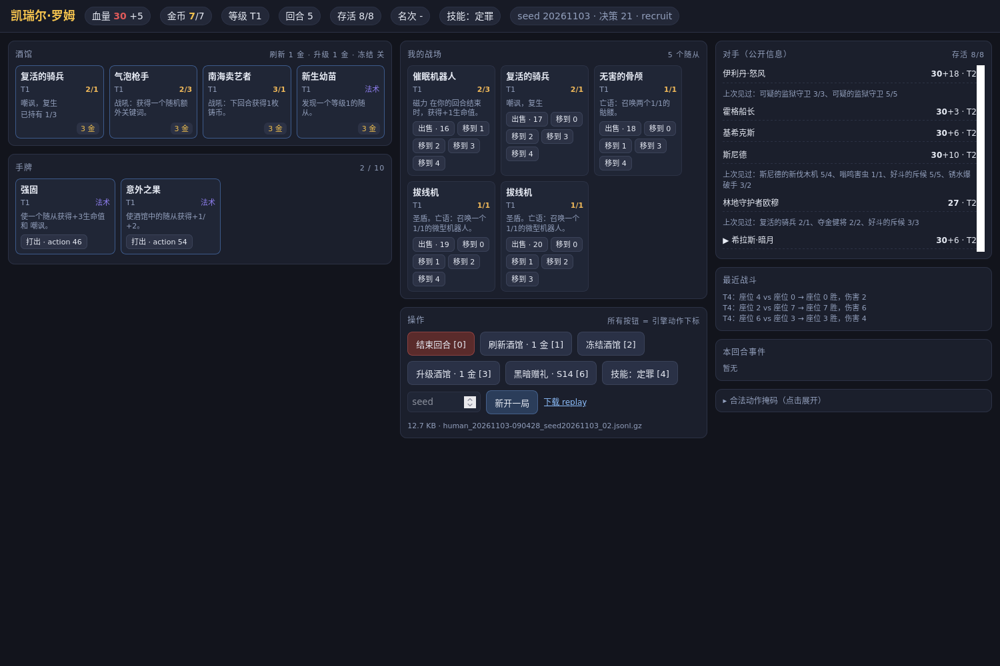
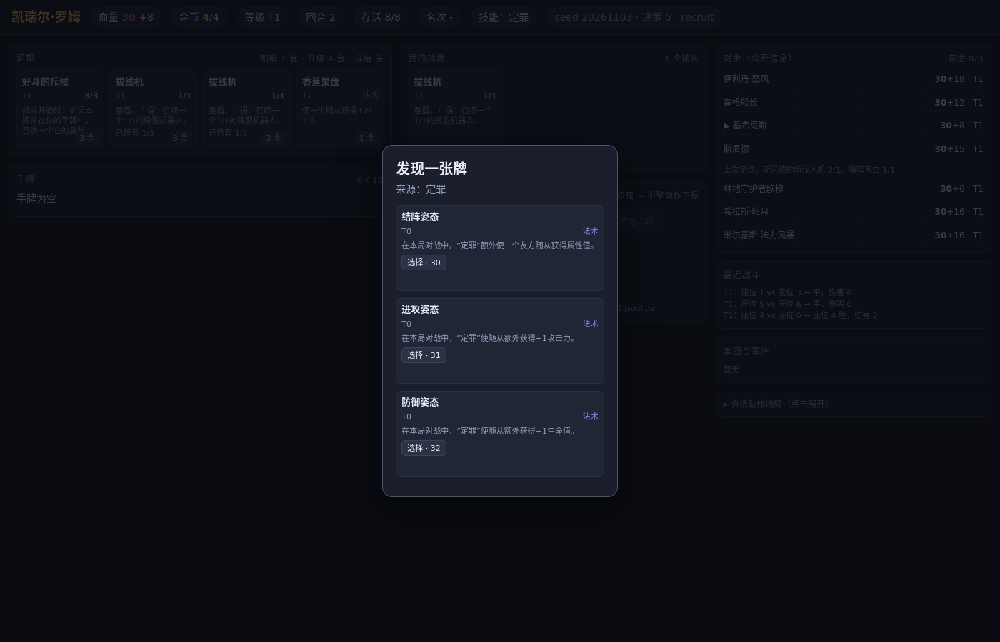

# 人类对战界面（Human Arena）

`scripts/human_arena.py`：零 Web 依赖的本地 UI（标准库 `http.server` + 内嵌 HTML/JS）。
人类占一个座位，其余 7 个座位由引擎原生 `Game.bot_play` 驱动，跑到对局结束；
每个人类决策按训练同口径（`features` 3227 + `cards` 124 + `mask` 245 + `action`）
落盘到 `runs/human_play/*.jsonl.gz`，可直接转成 BC 数据。**CPU 即可，不训练、不占 GPU。**





## 启动

```bash
# 远端仓库根目录（默认只绑 127.0.0.1:8000）
python scripts/human_arena.py --port 8000 --seed 1234

# 本机浏览器：把远端 8000 端口转发到本地
ssh -L 8000:127.0.0.1:8000 bicourse-glt
# 打开 http://127.0.0.1:8000
```

参数：`--seat 0`（人类座位）、`--out runs/human_play`（replay 目录）、
`--host`（默认 127.0.0.1，**改成 0.0.0.0 等于对网络开放，风险自担**）。
`GET /health` 是存活探针。

## 界面能做什么

按 `docs/HUMAN_ARENA_UI_SPEC.md` 做了信息升级（只改 UI 与 `/state` 白名单，**不改引擎、不占 GPU**）。

操作入口：点商店卡 = `Buy(slot)`（`8+slot`）；手牌「打出/磁力→随从j」chip = `Play{hand,pos}`
（`46+hand*8+pos`）/ `Magnetize`；战场 chip = 出售 `[16+slot]` / 发动 `[23+slot]` / 移到位置 j
`Move{from,to}`；技能 `[4+slot]`、黑暗之赐 `[6]`、刷新 `[1]`、冻结 `[2]`、升级 `[3]`、结束回合 `[0]`；
选择弹窗全部映射到 `Choose(i)`（`30+i`），可取消时给 `Cancel [7]`。

### 卡牌信息（商店 / 手牌 / 战场 / 选择弹窗共用）

- 中文名、种族（双种族全列，无种族写“无”）、`★N` tier 徽标、金卡“金色”文字 + 金边；
- 当前 `atk/hp` 与 `max_hp`（受伤/临时上限），动态关键词（嘲讽/圣盾/风怒/复生/烈毒/…）
  与**卡面**关键词（战吼/亡语/抉择/复仇/回合结束/战斗开始时/…，静态表只补卡面，
  不会把已经失去的动态圣盾“补回来”）；
- 卡面效果全文（标 `[卡面]`；引擎 `live_text` 时数字是当前值），实际价格：
  商店 `price/costs_health`、手牌 `play_cost`（当前引擎恒 0，不伪造）、饰品/选项 `cost/base_cost`；
- 磁力/宝石/赐福等附件（`attached`：名称+类型+效果）与数值拆解 `breakdown`
  （基础 / 已记录来源 / 本局 / 临时 / 其他 / 已受伤）；
- 卡图 `https://art.hearthstonejson.com/v1/orig/{card_id}.png`；加载失败 `onerror` 回退为
  文字占位，不阻塞任何操作、不把图当权威信息；
- 不可购买 / 不可打出 / 不可出售会写原因（金币不足、手牌已满、阶段不符、没有磁力目标）。

### 饰品 / 黑暗之赐

- 已获得小/大饰品常驻（名称 + 类型 + 效果）；第 6/9 回合 pending 四选一带完整效果与价格
  （`weight` 只是出价权重，不是胜率；回合数 ≠ 酒馆星级）；
- 黑暗之赐：费用、已用/上限、本回合是否已用、本回合/下回合可选星级、使用按钮与不可用原因
  （未解锁 / 本回合已用 / 已达上限 / 金币不足 / 阶段不符）。

### 对手 / 战果 / 操作

- 对手栏：英雄、生命与护甲分列、等级、存活/淘汰名次、下位对手与幽灵标记、公开饰品；
  上轮阵容标“第 X 回合交战时所见”，从未交战写“未知”，**不**转发 debug view 的实时棋盘；
- 自己的上轮战果：从完整 `combats` 过滤 `a==seat || b==seat` 后取最近一场，显示胜/负/平 + 伤害
  （可展开战斗帧 `frames`；引擎未记录时明确写“无战斗帧”；对局后期引擎滚掉旧记录时用本局缓存并标注）；
- 按钮文案 = 动作名 + 实际价格 + `[引擎动作下标]`；禁用按钮直接显示原因；
  请求处理中锁定提交（防双击重复购买）；非法动作的 HTTP 400 回包带 `action` 与可读原因，
  前端提示后刷新状态。

### 快照

`GET /snapshot` 返回注入状态 JSON + `<pre id="statetext">` 纯文本的静态 HTML；
`GET /snapshot.txt` 直接返回同一段中局状态文本（回合/种族/星级/商店/手牌/战场/饰品/黑暗之赐/
对手/上轮战果/按钮原因），便于截图与复盘，例如：

```text
=== 第 6 回合 · 招募 · 种子 1234 · 座位 0 ===
英雄：时光扭曲者克罗米  生命 30  护甲 6  金币 6/8  等级 T2  存活 8/8
本局种族：野兽/机械/野猪人/亡灵/畸变怪
  1 号位 獠牙露营者  ★1  野猪人  2/3  卡面关键词：集结
饰品（已获得 1）：
  [小饰品] 腐蚀的节杖
黑暗之赐：3 金 · 已用 0/3 · 本回合未用 · 可选星级 3/4（下回合 4）· 可用 [6]
```

`GET /replay` 下载本局 replay；「新开一局」按钮调 `POST /new {seed}`。

## 动作空间

前 245 项与 AutoTavern 逐位一致（`hsbg/env/action_space_std.py`，单一真源）：
`EndTurn 0 / Refresh 1 / Freeze 2 / Upgrade 3 / HeroPower 4-5 / DarkGift 6 / Cancel 7 /
Buy 8-15 / Sell 16-22 / Activate 23-29 / Choose 30-45 / Play 46-125 /
Magnetize 126-195 / Move 196-244`。扩展段 245+ 不参与掩码与本 UI。
非法动作（越界或 `mask[action]=0`）返回 HTTP 400 且不改变对局。

## replay 格式（`runs/human_play/human_<时间>_seed<seed>_<序号>.jsonl.gz`）

gzip JSONL，多 gzip member 拼接（`gzip.open` 正常读），每行一个对象：

- 首行 `{"type":"meta", game_version, seed, seat, n_actions:245, obs_floats:3227, obs_cards:124}`；
- 每个决策一行 `{"type":"decision", features:[3227], cards:[124], mask:[245],
  action, turn, tier, gold, phase, decision, action_name, seed, seat}`，`mask[action]=1` 恒成立；
- 结束行 `{"type":"summary", placement, placements, decisions, steps, turns}`（人类被淘汰后，
  bot 继续打完到 `Game.is_over()`，因此 summary 的 turns 可能大于人类最后一个决策回合）。

## 转成 BC 数据

```bash
python scripts/human_arena.py --to-npz runs/human_play --npz-out data/human_bc/human_play.npz
# 可选 --skip-hero-select：过滤英雄选择阶段
```

输出 npz 的字段与 `scripts/train_compound_bc.py::load_npz` 对齐：`obs (n,3351)` float32
（前 3227 观测 + 后 124 卡牌 id）、`cards int16`、`mask (n,245) bool`、`action int64`、
`turn/tier/gold/episode_id`；另存 `features float16` 便于复用现有工具。
训练时按 `--data <npz>` 直接读，`episode_id` 用于按局切 holdout。

## 自测 / 测试

```bash
# 脚本化人类跑完整一局 + 校验 replay + 转 npz（默认写 runs/human_play/）
python scripts/human_arena.py --selftest --seed 1234
# 8 项：动作映射/状态序列化/replay/完整局/BC 转换/HTTP
python -m pytest tests/test_human_arena.py -q
# 8 项：卡片字段/卡图回退/价格与原因/饰品/黑暗之赐/对手与战果/snapshot 文本/400 原因
python -m pytest tests/test_human_arena_ui.py -q
```

`--selftest` 会额外打印“中局状态文本”（与 `/snapshot.txt` 同款，含种族/关键词/饰品/赐福）。

限制：单用户、单进程；bot 在人类请求内推进（无动画）；UI 只展示公开对手信息；
卡图是在线增强，离线/加载失败时自动回退文字占位。
