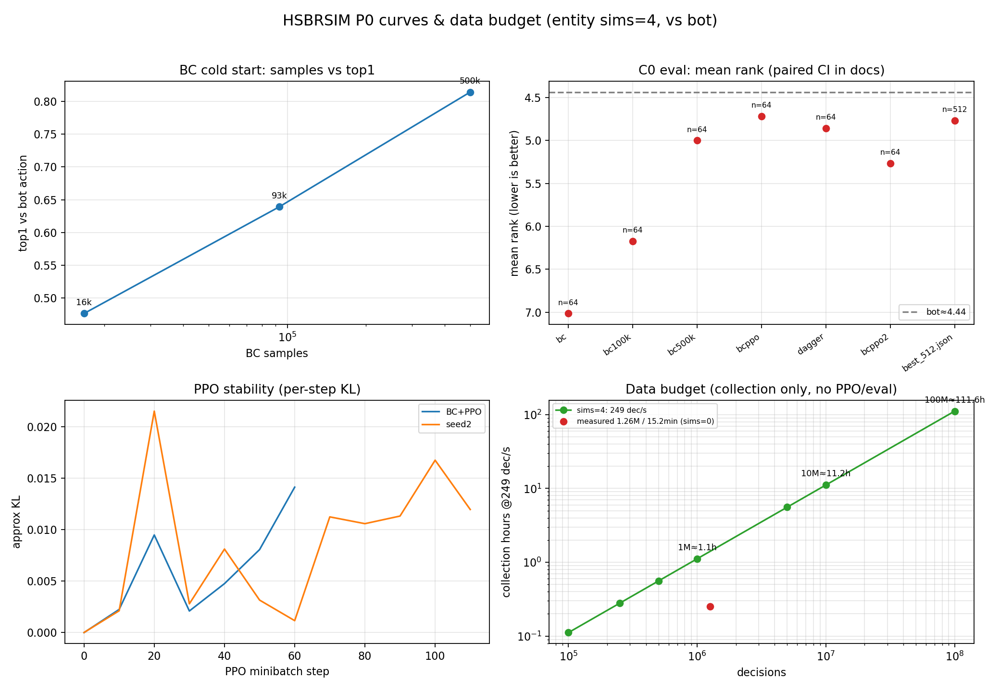

# 多 Stage 训练与数据预算讨论

> 图：左上 BC 样本量 vs top1；右上 C0 mean rank（n=64/512，paired CI 在文档表格）；
> 左下 PPO 每 minibatch KL；右下按当前 entity sims=4 的 249 decisions/s 估算采集预算。

## 1. 当前结论

单 stage 的 50k–114k PPO 已经把链路跑通，但 C0 强度没有过：

| 模型 | 数据 | C0 mean rank | bot | top4 |
|---|---:|---:|---:|---:|
| 随机 entity | 0 | 7.98 | 4.67 | 0% |
| BC | 16.7k | 7.02 | 4.64 | 4.7% |
| BC | 93k | 6.17 | 4.39 | 20.3% |
| BC | 500k | 5.00 | 4.39 | 42.2% |
| BC + PPO | 500k + 62k | 4.72（64局） | 4.38 | 48.4% |
| BC + PPO（512局） | 同上 | **4.77** | **4.44** | **45.3%** |
| DAgger | 500k + 34k | 4.86–5.59 | 4.4–4.5 | 33–47% |

- BC 是当前最有效的冷启动：500k 把 8.0 拉到 5.0；
- PPO 只再改善约 0.1–0.3；
- DAgger 提高 top1 但实际名次没有变好；
- 512 局配对 CI 仍为 **[0.06, 0.61]**，显著弱于 bot。

**单次 50k PPO 不是数据量问题，而是“没有 stage/对手课程”的问题。**

## 2. 实测吞吐与预算

当前 entity、sims=4、64 workers、bot：

- 50,510 decisions 采集 **203s** ≈ **249 decisions/s**；
- PPO 50k ≈ **10.6s**（50 updates，minibatch 1024）；
- 512 局 C0 评测 ≈ **347s**；
- BC 500k：采集 26.6s + 训练约 7.5min。

### 采集预算（仅采集）

| decisions | 采集时间 @249/s |
|---:|---:|
| 50k | 3.4 min |
| 250k | 17 min |
| 1M | **1.1 h** |
| 5M | **5.6 h** |
| 10M | **11.2 h** |
| 100M | **111.6 h** |
| 310M（论文单 stage 量级） | **~346 h / 14.4 天** |

注意：以上**不含** PPO、评测、IO、重搜；实际 stage 要加 10–20%。
1M stage 实际约 **1.2–1.4h**；5M 约 **6–8h**。

### 论文规模

论文 300 iterations × 1M decisions ≈ **310M decisions**。  
在单张 4090、当前 249/s 下约 **14.4 天仅采集**，不可作为本地默认预算。  
要么接受小 stage，要么提高吞吐/多卡。

## 3. 多 stage 方案

### S0：BC 冷启动（已做）

- 500k bot 示范；
- ~8min；
- top1 0.814，C0 5.0；
- 作用：把随机策略拉入“会买牌/会打牌”的分布。

### S1：C0 PPO 1M（建议先跑）

- 从 BC500k 初始化；
- 1M decisions vs bot，sims=4；
- KL anchor（前 20–30% updates，β 0.1→0）；
- 每 250k 做一次 512 局 C0 评测；
- 预算：采集 1.1h + PPO/评测 ≈ **1.5h**；
- 成功标准：C0 配对 CI 上界 <0，或至少 mean rank <4.5。

### S2：2M 失败后的扩展

- 继续从 S1 checkpoint；
- 2M decisions，加入：
  - 历史 checkpoint 对手池（30% bot + 70% 历史）；
  - 对局长度/回合课程；
- 预算：采集 2.2h + 训练/评测 ≈ **3h**；
- 如果 2M 仍无改善，停止盲加数据。

### S3：5M + 联赛

- 4–8 个历史成员，单 learner；
- bot 比例从 50% 退火到 10%；
- 预算：5.6h 采集 + 训练/评测 ≈ **7–8h**；
- 只有 S2 有正趋势才做。

### 总预算建议

| 方案 | 数据 | 估计 wall-clock | 适用 |
|---|---:|---:|---|
| 最小验证 | 1M | ~1.5h | 先看 C0 是否动 |
| 推荐 | 5M 分 stage | ~7–8h | 有明确趋势再做 |
| 激进 | 10M | ~12–14h | 单卡上限附近 |
| 论文规模 | 310M | ~14 天采集 | 本机不可行 |

## 4. 为什么必须多 stage

单 stage 的问题不是“训练不够久”，而是：

1. **对手固定**：全程完整 bot，模型只见过一种对手；
2. **奖励稀疏**：输/赢的 rank 信号在 8 人局里方差大；
3. **无 KL anchor**：50k 后可漂移（第二轮 PPO 从 4.72 退化到 5.27）；
4. **无历史池**：不能形成“我不会打自己”的课程；
5. **BC 只能逼近 bot**：BC 500k 的 top1 0.814，单靠 BC 不可能稳定超过 teacher。

因此需要：

- S0 BC；
- S1 bot PPO + KL anchor；
- S2 历史 checkpoint 池；
- S3 联赛/真实对手库；
- 每 stage 固定 512 局评测，不用 64 局小样本做决策。

## 5. 可视化读法

- **左上**：BC 样本量从 16k→500k，top1 0.477→0.814，仍有收益但边际递减；
- **右上**：C0 从 8.0→4.77，bot 4.44；所有模型都在 bot 下方，没有 crossing；
- **左下**：PPO KL 在 step 20–30 和 100 附近有尖峰（~0.02），说明 50k 单 stage 的稳定性不足，KL anchor 必要；
- **右下**：1M≈1.1h、5M≈5.6h、10M≈11.2h；310M≈14 天，明确排除“本地照搬论文”。

## 6. 需要你决定

1. **先跑 S1 1M（~1.5h）**，看 C0 是否从 4.77 明显下降；
2. 还是直接 **S1+S2 3M（~4–5h）**；
3. 还是先 **模型对齐 56+1 token / 18M**，再训练；
4. 是否允许引入 **历史 checkpoint 池/对手库**（这是最可能突破 C0 的，但超出当前 P0 工程）。

我的建议：**先 S1 1M + KL anchor**；如果 C0 仍无趋势，再决定是否投入 5M/联赛。不要在 50k 单 stage 上继续重复 PPO。

## 7. 1M PPO 实测（sims=0）

按 10 × 1000 局跑完，实际 **1,259,447 decisions**（不是精确 1M）：

| 指标 | 值 |
|---|---:|
| decisions | 1,259,447 |
| collection | 910s（15.2min） |
| 吞吐 | ~1,384 decisions/s（sims=0） |
| PPO | 10 iterations，10 updates |
| C0 512 局 mean rank | **4.709** |
| bot | 4.506 |
| top4 | 45.7% |
| paired Δ CI | [-0.039, +0.459] |
| C0 gate | ❌ 未过 |

结论：从 4.77 只降到 4.71，**1M sims=0 的 scaling 很弱**；  
1M sims=4 的 2700 局大批次 run 在当前线程模型下出现长时间无进度，未作为有效证据；  
后续应使用 10×1000 分片 + sims=4，而不是单批 2700 局。
