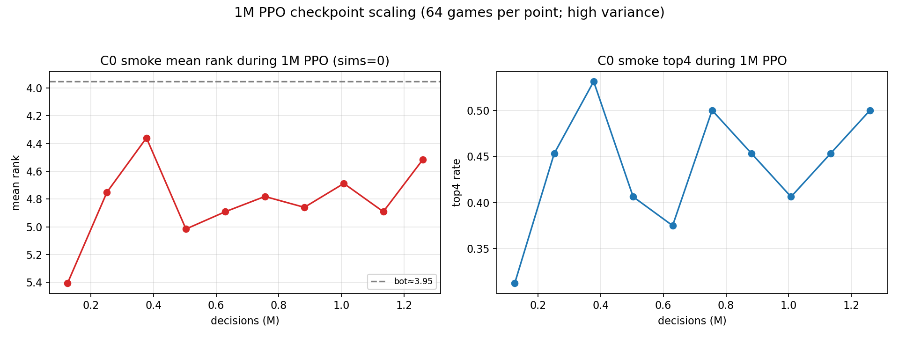

# 多 Stage 训练与数据预算讨论


> 图：左上 BC 样本量 vs top1；右上 C0 mean rank（n=64/512，paired CI 在文档表格）；
> 左下 PPO 每 minibatch KL；右下按当前 entity sims=4 的 249 decisions/s 估算采集预算。

## 1. 当前结论

单 stage 的 50k–114k PPO 已经把链路跑通，但 C0 强度没有过：

| 模型 | 数据 | C0 mean rank | bot | top4 |
|---|---:|---:|---:|---:|
| 随机 entity | 0 | 7.98 | 4.67 | 0% |
| BC | 16.7k | 7.02 | 4.64 | 4.7% |
| BC | 93k | 6.17 | 4.39 | 20.3% |
| BC | 500k | 5.00 | 4.39 | 42.2% |
| BC + PPO | 500k + 62k | 4.72（64局） | 4.38 | 48.4% |
| BC + PPO（512局） | 同上 | **4.77** | **4.44** | **45.3%** |
| DAgger | 500k + 34k | 4.86–5.59 | 4.4–4.5 | 33–47% |

- BC 是当前最有效的冷启动：500k 把 8.0 拉到 5.0；
- PPO 只再改善约 0.1–0.3；
- DAgger 提高 top1 但实际名次没有变好；
- 512 局配对 CI 仍为 **[0.06, 0.61]**，显著弱于 bot。

**单次 50k PPO 不是数据量问题，而是“没有 stage/对手课程”的问题。**

## 2. 实测吞吐与预算

当前 entity、sims=4、64 workers、bot：

- 50,510 decisions 采集 **203s** ≈ **249 decisions/s**；
- PPO 50k ≈ **10.6s**（50 updates，minibatch 1024）；
- 512 局 C0 评测 ≈ **347s**；
- BC 500k：采集 26.6s + 训练约 7.5min。

### 采集预算（仅采集）

| decisions | 采集时间 @249/s |
|---:|---:|
| 50k | 3.4 min |
| 250k | 17 min |
| 1M | **1.1 h** |
| 5M | **5.6 h** |
| 10M | **11.2 h** |
| 100M | **111.6 h** |
| 310M（论文单 stage 量级） | **~346 h / 14.4 天** |

注意：以上**不含** PPO、评测、IO、重搜；实际 stage 要加 10–20%。
1M stage 实际约 **1.2–1.4h**；5M 约 **6–8h**。

### 论文规模

论文 300 iterations × 1M decisions ≈ **310M decisions**。  
在单张 4090、当前 249/s 下约 **14.4 天仅采集**，不可作为本地默认预算。  
要么接受小 stage，要么提高吞吐/多卡。

## 3. 多 stage 方案

### S0：BC 冷启动（已做）

- 500k bot 示范；
- ~8min；
- top1 0.814，C0 5.0；
- 作用：把随机策略拉入“会买牌/会打牌”的分布。

### S1：C0 PPO 1M（建议先跑）

- 从 BC500k 初始化；
- 1M decisions vs bot，sims=4；
- KL anchor（前 20–30% updates，β 0.1→0）；
- 每 250k 做一次 512 局 C0 评测；
- 预算：采集 1.1h + PPO/评测 ≈ **1.5h**；
- 成功标准：C0 配对 CI 上界 <0，或至少 mean rank <4.5。

### S2：2M 失败后的扩展

- 继续从 S1 checkpoint；
- 2M decisions，加入：
  - 历史 checkpoint 对手池（30% bot + 70% 历史）；
  - 对局长度/回合课程；
- 预算：采集 2.2h + 训练/评测 ≈ **3h**；
- 如果 2M 仍无改善，停止盲加数据。

### S3：5M + 联赛

- 4–8 个历史成员，单 learner；
- bot 比例从 50% 退火到 10%；
- 预算：5.6h 采集 + 训练/评测 ≈ **7–8h**；
- 只有 S2 有正趋势才做。

### 总预算建议

| 方案 | 数据 | 估计 wall-clock | 适用 |
|---|---:|---:|---|
| 最小验证 | 1M | ~1.5h | 先看 C0 是否动 |
| 推荐 | 5M 分 stage | ~7–8h | 有明确趋势再做 |
| 激进 | 10M | ~12–14h | 单卡上限附近 |
| 论文规模 | 310M | ~14 天采集 | 本机不可行 |

## 4. 为什么必须多 stage

单 stage 的问题不是“训练不够久”，而是：

1. **对手固定**：全程完整 bot，模型只见过一种对手；
2. **奖励稀疏**：输/赢的 rank 信号在 8 人局里方差大；
3. **无 KL anchor**：50k 后可漂移（第二轮 PPO 从 4.72 退化到 5.27）；
4. **无历史池**：不能形成“我不会打自己”的课程；
5. **BC 只能逼近 bot**：BC 500k 的 top1 0.814，单靠 BC 不可能稳定超过 teacher。

因此需要：

- S0 BC；
- S1 bot PPO + KL anchor；
- S2 历史 checkpoint 池；
- S3 联赛/真实对手库；
- 每 stage 固定 512 局评测，不用 64 局小样本做决策。

## 5. 可视化读法

- **左上**：BC 样本量从 16k→500k，top1 0.477→0.814，仍有收益但边际递减；
- **右上**：C0 从 8.0→4.77，bot 4.44；所有模型都在 bot 下方，没有 crossing；
- **左下**：PPO KL 在 step 20–30 和 100 附近有尖峰（~0.02），说明 50k 单 stage 的稳定性不足，KL anchor 必要；
- **右下**：1M≈1.1h、5M≈5.6h、10M≈11.2h；310M≈14 天，明确排除“本地照搬论文”。

## 6. 需要你决定

1. **先跑 S1 1M（~1.5h）**，看 C0 是否从 4.77 明显下降；
2. 还是直接 **S1+S2 3M（~4–5h）**；
3. 还是先 **模型对齐 56+1 token / 18M**，再训练；
4. 是否允许引入 **历史 checkpoint 池/对手库**（这是最可能突破 C0 的，但超出当前 P0 工程）。

我的建议：**先 S1 1M + KL anchor**；如果 C0 仍无趋势，再决定是否投入 5M/联赛。不要在 50k 单 stage 上继续重复 PPO。

## 7. 1M PPO 实测（sims=0）

按 10 × 1000 局跑完，实际 **1,259,447 decisions**（不是精确 1M）：

| 指标 | 值 |
|---|---:|
| decisions | 1,259,447 |
| collection | 910s（15.2min） |
| 吞吐 | ~1,384 decisions/s（sims=0） |
| PPO | 10 iterations，10 updates |
| C0 512 局 mean rank | **4.709** |
| bot | 4.506 |
| top4 | 45.7% |
| paired Δ CI | [-0.039, +0.459] |
| C0 gate | ❌ 未过 |

结论：从 4.77 只降到 4.71，**1M sims=0 的 scaling 很弱**；  
1M sims=4 的 2700 局大批次 run 在当前线程模型下出现长时间无进度，未作为有效证据；  
后续应使用 10×1000 分片 + sims=4，而不是单批 2700 局。

## 8. 1M sims=4 的失败尝试（2026-10-27）

- 配置：10 × 1000 局，64 workers，sims=4，max_steps=3000；
- 第一个 1000 局 shard 在 **21.5 min** 后仍未完成（`history.json` 未生成）；
- 按此速度 1M 需 **>3.5h**，超出 1.5–2h 预算，已停止；
- 根因：64 个 Python 线程 + MCTS 搜索在 GIL/逐叶同步下不扩展；不是 GPU 不足；
- 只有 sims=0 的 1M 完成（1.259M / 15.2min / C0 4.709）。

结论：**1M sims=4 需要先做 4–8 actor × 多局/多树 + 真正批搜索，不能靠 64 线程硬堆。**

## 9. 1M checkpoint scaling（每 125k，64 局）



| decisions | mean rank | top4 |
|---:|---:|---:|
| 0.126M | 5.406 | 31.3% |
| 0.252M | 4.750 | 45.3% |
| 0.378M | **4.359** | 53.1% |
| 0.504M | 5.016 | 40.6% |
| 0.630M | 4.891 | 37.5% |
| 0.756M | 4.781 | 50.0% |
| 0.882M | 4.859 | 45.3% |
| 1.008M | 4.688 | 40.6% |
| 1.133M | 4.891 | 45.3% |
| 1.259M | 4.516 | 50.0% |

- 64 局点的 bot mean rank 是 3.95（该 seed 集），与 512 局的 4.51 不同；
- 曲线**非单调**，0.38M 最好、0.50M 又退化；
- 每个点只有 64 局，噪声大；最终 1.259M 用 512 局为 4.709；
- 结论：**BC scaling 明确，PPO 1M scaling 不明确**；不能仅凭 64 局曲线说“scaling 明确”。

### 512 局复核关键 checkpoint

- 64 局最优的 0.378M checkpoint，用 512 局复测：mean **4.7695**，bot 4.535，top4 45.1%，CI [-0.031, 0.490]；
- 1.259M 最终模型：mean **4.709**，bot 4.506，top4 45.7%，CI [-0.039, 0.459]；
- 64 局的 4.36 是**噪声**；1M 内没有 checkpoint 能通过 C0 gate。

结论：**PPO 1M 的 scaling 不成立**，不要用 64 局曲线选 checkpoint。

> 多 GPU / 多 CPU / 6–12h 预算见 [COMPUTE_PLAN_4GPU.md](COMPUTE_PLAN_4GPU.md)。

## 10. 进程级 actor + sims=4 PPO 1.08M（2026-10-27 21:30，**负结果**）

背景：进程级 actor pool 修复后（[COMPUTE_BENCHMARK.md](COMPUTE_BENCHMARK.md) §10：
684.9 decisions/s，3.6×），用 8 进程 × 16 线程在 GPU 0/5/6/7 上续训，验证
「同算力下 sims=4 的 PPO 能否把 C0 从 4.709 推过 bot」。

```bash
PYTHONPATH=rust/python:. python scripts/train_entity_sync.py \
  --checkpoint runs/az_entity_1m_s0/model.pt --arch entity --device cuda:0 \
  --processes 8 --gpus 0,5,6,7 --threads 16 --games 128 \
  --sims 4 --determinizations 1 --opponent bot --behavior net \
  --epochs 1 --minibatch 1024 --lr 1e-5 --target-kl 0.1 \
  --pi-coef 0.1 --entropy-coef 0.005 --max-steps 10000 \
  --iterations 60 --snapshot-every 5 --keep-snapshots 3 --seed 700 \
  --out runs/az_entity_ppoproc_1m
```

| 项目 | 结果 |
|---|---|
| 迭代 / decisions / wall-clock | 60 / **1,081,079** / 1,874 s（31.2 min，含 PPO 更新） |
| 采集吞吐 | p50 **719.6** dec/s（min 553 / max 863）；端到端 576.8 dec/s |
| queue wait p95 | 中位 13.5 ms，最差 14.4 ms；worker 重启 0 |
| PPO 稳定性 | approx_kl 0.0016→0.0040，clip_frac 1.9%→3.6%，entropy 0.43→0.27 |
| C0 512 局（seed_base 410000，与基线同协议） | mean rank **5.465**，bot 4.506，top4 **29.5%**，win 4.5% |
| 配对 Δ（model−bot） | **+0.959**，95% CI **[+0.693, +1.227]** → 显著**更差** |

判读：**工程链路成功（1M/31min、零重启、可续训），但强度明显退化**——同 seed 同协议下
从续训前的 4.709 掉到 5.465，退 **0.76 名**且 CI 不含 0。可能原因（按优先级）：

1. `pi_coef=0.1` 把 sims=4、W=1 的 MCTS visit π 蒸馏进策略；而 4 次模拟的 π 本身不比网络强
   （见 [AZ_IMPERFECT_SEARCH_DESIGN.md](AZ_IMPERFECT_SEARCH_DESIGN.md) §5.3），等于用更差的
   教师反复教策略；
2. 没有 KL anchor（本文 §5 已标未实现），60 次更新累计漂移；
3. 采集用采样行为（temperature 1.0）、C0 用 greedy argmax，分布偏移；
4. 8 人局单 learner 时终局 rank 信号方差大，advantage 近 0。

下一步（建议按序，**不要再单纯加步数**）：

- **A（最便宜）**：同配置 `--pi-coef 0`（纯 PPO，不蒸馏 MCTS），每 250k 做一次 512 局评测，
  确认退化是否来自 π 蒸馏；
- **B**：加 KL anchor（β 0.1→0）后重复 A；
- **C**：若 A/B 仍退化，说明 sims=4 的搜索数据对 greedy 网络没有正收益，应转向更深搜索
  （sims 32–64）/更强教师或历史池课程，而不是继续加 PPO 步数。

产物：`runs/az_entity_ppoproc_1m/{model.pt,history.json,summary.json,snapshots/,c0_512.json}`
（`runs/` 不入库）。

## 11. pi_coef 消融 + 采样/贪心评测分歧（2026-10-27 22:30）

§10 猜测「退化来自 MCTS π 蒸馏」。用**同 seed（700）、同初始化、同数据顺序**只改
`--pi-coef 0.1 → 0.0` 复跑 60 iter / 1,095,390 decisions（2,010.6 s，采集 p50 703.3 dec/s），
并在**同一 64 局面板**（seed_base 410000、8 seat × 8）上评测各检查点：

| 模型 | 约 decisions | mean rank | bot | top4 | Δ(model−bot) |
|---|---:|---:|---:|---:|---:|
| PPO 之前（1M sims=0 基线） | 0 | **4.781** | 4.391 | 46.9% | +0.391 |
| pi_coef=0 · step016 | 290k | 4.906 | 4.391 | 37.5% | +0.516 |
| pi_coef=0 · step031 | 560k | 5.078 | 4.391 | 32.8% | +0.688 |
| pi_coef=0 · step046 | 830k | 5.594 | 4.391 | 23.4% | +1.203 |
| pi_coef=0 · final | 1.095M | **6.172** | 4.391 | 12.5% | +1.781 |
| pi_coef=0.1 · step046 | ~830k | 5.266 | 4.391 | 34.4% | +0.875 |
| pi_coef=0.1 · step051 | ~930k | 5.266 | 4.391 | 35.9% | +0.875 |
| pi_coef=0.1 · step056 | ~1.02M | 5.609 | 4.391 | 26.6% | +1.219 |

**结论 1：退化不是 π 蒸馏造成的。** `pi_coef=0` 同样单调退化（4.78 → 6.17），而且比
`pi_coef=0.1` **更差**（512 局：5.465 vs 6.17@64局同趋势）——MCTS π 在这里反而起到轻微的
正则/教师作用，与 §10 的猜测相反。

**结论 2：采样策略也在变差，不只是贪心。** 用 `behavior=net`（temperature 1.0、sims=0）
在同一 seed 上评 64 局：基线 **4.531**（top4 48.4%）→ pi_coef=0 final **5.188**（top4 32.8%）。
所以不是「只有 argmax 变坏」，而是策略整体在退化，贪心退化更多（+1.39 vs +0.66）。

**结论 3：C0 的 greedy 协议低估了模型。** 同一基线 checkpoint：贪心 4.781 / 采样 **4.531**；
训练温度 1.0 的策略熵仍有 0.41–0.43，greedy argmax 对 logit 微小变化很脆。用单一 greedy
协议选 checkpoint 会系统性低估，也会掩盖采样侧的改善。

**判读**：在「1 learner vs 7 个固定 bot、约 130 decisions/局、终局单一 rank 奖励、γ=1」的设定下，
lr=1e-5 的 PPO 每轮都能把 critic 拟合得更好（value_loss 1.78→1.60），但策略侧只拿到极弱且
高方差的 advantage；没有 KL anchor，60×17 次更新后净效果是**离 BC 初始解越来越远**。
这解释了历史上「50k 有改善、1M 反退化、第二轮 4.72→5.27」的重复模式。

**下一步（修订 §10 的建议）**：

1. **停止用「加步数」提升强度**；当前最强仍是 `runs/az_entity_1m_s0/model.pt`（512 局 4.709）。
2. 实作 **KL anchor**（冻结 stage 起点，β 0.1→0）+ **每 100k 做 512 局评测**，按评测选
   checkpoint（而非取最后一次）。若 anchor 后仍退化，判定为「PPO 目标不适配」，转 3。
3. 若要继续这条线，先解决信号问题：更深的搜索教师（sims 32–64）或历史 checkpoint 池，
   让 advantage 不再是「8 座同 rank 的零均值噪声」。
4. 评测协议统一成 **greedy + 采样两栏**，避免用单一协议下结论。

产物：`runs/az_entity_ppoproc_1m_pi0/{model.pt,history.json,summary.json,snapshots/step_*}`、
`runs/az_entity_ppoproc_1m{,_pi0}/c0_64_*.json`（含基线锚点）。
