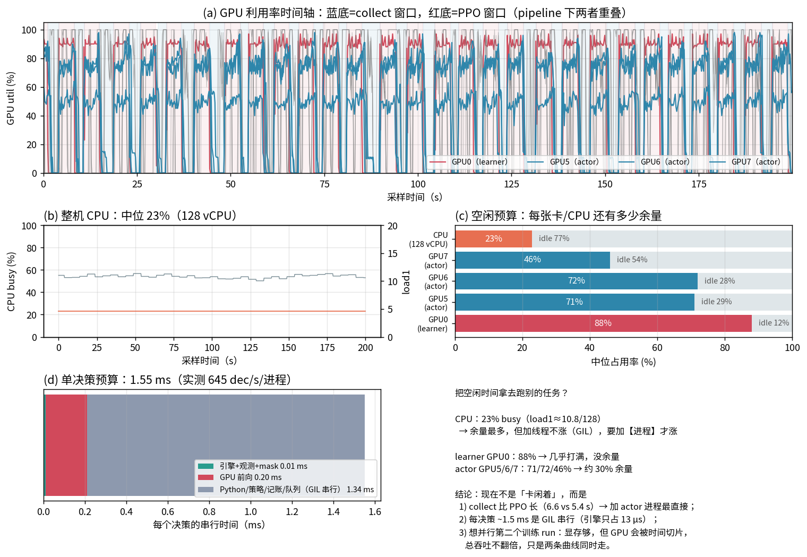

# 资源时间轴 profile：谁在限速、空闲能干什么、4 卡怎么排更划算

> 采样：`scripts/resource_sampler.py`（0.2 s，200 s，只读 nvidia-smi + /proc/stat），
> 对象是正在跑的 stage-2（pipeline + bf16，learner=GPU0，actors=GPU5/6/7）。
> 单决策成本：`scripts/bench_decision_cost.py`（纯 CPU）。
> 图：`scripts/plot_resource_profile.py` → `docs/assets/resource_profile.png`。



## 1. 现在各资源到底多忙（中位值）

| 资源 | 占用 | 空闲 | 说明 |
|---|---:|---:|---|
| GPU0（learner / PPO） | **88%** | 12% | 基本打满；bf16 后 PPO 已接近该模型上限 |
| GPU5（actor×3） | 71% | 29% | |
| GPU6（actor×3） | 72% | 28% | |
| GPU7（actor×2） | **46%** | 54% | **8 个进程摊在 3 张卡上：3/3/2，这张只分到 2 个** |
| CPU（128 vCPU） | **23%**（load1≈10.8） | 77% | 大量空闲；但线程数不是瓶颈（GIL） |
| 磁盘 | 读 32 / 写 17 MB/s | ~99% | records 431 MB/iter 也没有打满盘 |

## 2. 限速步的层次（按贡献排序）

**(1) 每决策 ≈1.55 ms 的 GIL 串行时间**（8 进程各 645 dec/s 反推）：

| 组成 | 时间 | 占比 |
|---|---:|---:|
| 引擎 step + 观测 + mask + bot_action | **0.011 ms** | 0.7% |
| GPU 前向（entity，B≈7） | ~0.20 ms | 13% |
| **Python：策略记账 / records dict / numpy 转换 / 队列与 batch server 等** | **~1.34 ms** | **86%** |

也就是说：**引擎和 GPU 都不是墙，GIL 里的 Python 代码才是**。这解释了为什么 CPU 只用 23%、
GPU 却上不去——每个进程一次只能跑一段 Python。

**(2) actor 进程数 vs 卡数不匹配**：8 进程 / 3 卡 = 3/3/2，GPU7 只用 46%，
相当于浪费了 ~0.5 GPU 的时间；而 collect（5.28 s）比 PPO（5.4 s）几乎相等，谁都不能拖后腿。

**(3) 每 iteration 的固定开销 ~0.74 s**：collect wall 5.28 s，而 8 个 worker 自己平均只跑 4.54 s；
差额是「任务开始时 8 个 worker 各自 `torch.load` 61 MB 权重」+ 父进程读 431 MB records /
构 batch。这部分完全不产生决策。

**(4) worker 长尾**：最后一轮 8 个 worker 用时 4.18–5.56 s（max/mean = 1.22），
静态按局分配 → 最慢的那个决定整轮时长，尾部损失 ~0.6 s。

**(5) learner 88%**：PPO 侧已没多少余量（bf16 是 1.67×；更大微批实测更差）。

## 3. 「空闲时间能拿去跑别的任务吗」

- **CPU 77% 空闲**：能，但**加线程不涨、加进程才涨**（GIL）。→ 最直接的动作是把 actor 进程
  从 8 加到 9/12（每卡 3/4 个），预计 collect 5.28 → 4.2–4.5 s。
- **actor 卡合计 ~1.1 GPU·s/s 空闲**：足够把 **512 局评测放到 actor 卡上跑**（现在评测会
  暂停训练 400–490 s/次，30M 里共 ~40 min）；也够跑一个小的第二任务（如镜入库采集）。
- **learner 卡 12% 空闲**：太碎，不值得切分。
- **并行第二个训练 run**：显存够（每张卡都有 15–22 GB 空闲），但 **GPU 是时间切片**，
  两条曲线各拿一半 → **总吞吐不会翻倍**，只是同时推进两个实验。若目标是「更快出结果」，
  这不如把 4 卡都留给一个 run。

## 4. 建议的下一步（按收益/风险排序）

| # | 动作 | 预期 | 风险 |
|---|---|---|---|
| A | **actor 进程 8 → 12（4/3/3/3 或 4/4/4），线程 16 → 12** | collect 5.28 → ~4.2–4.5 s；端到端 +10–15% | 低（只是参数；CPU 有余量） |
| B | **worker 权重预取**：任务结束时预加载下一版（或共享内存传 tensor），把「每轮 0.74 s 的 load/dispatch」移出关键路径 | collect −0.4–0.6 s | 中（要改 worker 生命周期，需 lag 断言回归） |
| C | **动态分片**：按局派发而不是静态 24 局/进程，削掉 0.6 s 长尾 | collect −0.4–0.6 s | 低-中（需处理跨进程任务队列） |
| D | **评测移到 actor 卡并行**（不暂停训练） | 30M 省 ~40 min（≈ -3% 总时长） | 低（已有 `--eval-device`） |
| E | Rust actor / 批式推理（`docs/ACTOR_RUST_OPTIONS.md` 方案 B） | 每决策 Python 1.34 ms 大幅下降，collect 可翻倍 | 高（改引擎 API） |

**关键取舍**：A+B+C 做完，collect ≈ 3.5–4 s，而 PPO 仍要 5.4 s →
**限速步会从「采集」切换到「PPO」**，届时 4 卡再多给 actor 也没用。所以：
- 短期先做 A（今天就能测）；B/C 一起做；
- 中期若还要更快，只能动 PPO：更小模型/更少样本每更新，或上多卡 learner（DDP）；
- Rust actor（E）只在「PPO 已不是瓶颈」之后才划算。

## 5. 复现命令

```bash
P=/home/data/users/gaoletian/.conda/envs/hiermolgen/bin/python
cd /home/data/users/gaoletian/projects/HSBRSIM

# 采样（只读，不影响训练）
$P scripts/resource_sampler.py --seconds 200 --interval 0.2 \
   --out runs/profile_resource/sample.jsonl

# 单决策 CPU 成本
PYTHONPATH=rust/python:. $P scripts/bench_decision_cost.py --games 2 \
   --out runs/profile_resource/decision_cost.json

# 画图 + 打印空闲预算
PYTHONPATH=rust/python:. $P scripts/plot_resource_profile.py --run runs/az_entity_s2 \
   --out runs/plots/resource_profile.png
```

> 注意：采样期间 GPU1–4 被其它作业占用（util 19–100%、显存 15–19 GB），
> 我们的 0/5/6/7 与它完全不重叠——没有抢卡。
