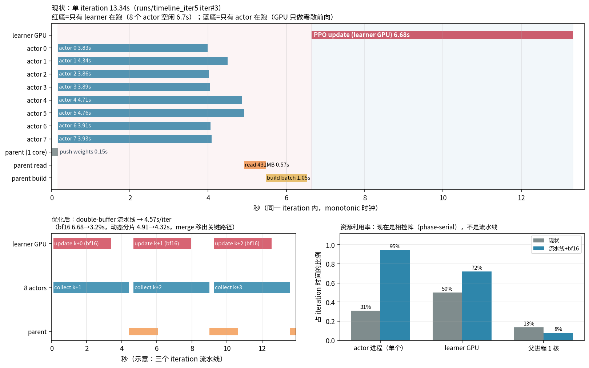

# 单 iteration 时间轴：谁在等谁、限速步是什么、并行怎么改才可靠

> 数据：`runs/timeline_iter5`（5 个 iteration，逐阶段 + 逐 worker 打了 `time.monotonic()` 时间戳），
> 图：`runs/profile_timeline/iteration_timeline.png`，脚本：`scripts/plot_iteration_timeline.py`。
> 环境：8 个 actor 进程 × 16 线程（GPU 0/5/6/7）、entity 14.8M、sims=0、192 games/iter、fp32 PPO。

## 1. 实测时间轴（iter #3，总 13.34 s）

| 区间 | 时刻 | 内容 | 谁在忙 |
|---|---|---|---|
| 0.00–0.15 | 0.15 s | 父进程存 61 MB 权重并推给 8 个 worker | 父进程 1 核（8 actor 等待） |
| 0.15–4.9 | 4.8 s | 8 个 actor 并行采集（每进程 24 局） | 8 进程 + 4 张 GPU 零散前向 |
| 4.9–5.5 | 0.57 s | 父进程读回 431 MB records | 父进程 1 核（**8 actor + GPU 全空闲**） |
| 5.5–6.5 | 1.05 s | `build_batch_from_records`（np.stack + GAE） | 父进程 1 核（**同上全空闲**） |
| 6.65–13.32 | 6.68 s | PPO 更新（30 个 1024 微批，fp32） | learner GPU（**8 actor 全空闲**） |
| 13.32–13.34 | 0.02 s | 写 history.json（此刻历史还小） | 父进程 1 核 |

资源利用率（这一轮）：**actor 单进程 31%、learner GPU 50%、父进程单核 13%**。
也就是说任何时刻都有 ≥50% 的资源在空转——这是 phase-serial（相控阵）排程，不是流水线。

## 2. 限速步到底是什么

分三层，**不同阶段限速步不同**，所以「一个数字」回答不了：

| 阶段 | 真正的限速步 | 证据 |
|---|---|---|
| 采集（4.8 s） | **每个 actor 进程内的 Python/GIL + 逐叶回调**；不是 GPU，也不是 CPU 核数 | GPU util 32%（30 min 扫描）、batch fill 0.11、queue p95 13 ms；8 进程 × 16 线程只到 6,879 dec/s |
| 采集尾部 | **静态分片的长尾**：8 个 worker 分别是 3.83/4.34/3.86/3.89/4.71/4.76/3.91/3.93 s，最慢比均值多 **0.61 s（15%）** | 上图 actor 行长度差；每进程固定 24 局，局有长短 |
| 合并（1.62 s） | **单核 + pickle**：431 MB records 读回 0.57 s、np.stack+GAE 1.05 s | `parent_read_s` / `build_batch_s` |
| 更新（6.68 s） | **fp32 前向/反向**：1024 微批 202.9 ms，bf16 只需 100.2 ms（2.03×） | `scripts/plot_iteration_timeline.py` 报告 + 微基准 |
| 长训练后段 | **history.json 全量重写**：97 MB `json.dumps(indent=2)` 3.61 s/iter（单条 entry 94 KB，其中 `worker_meta` 40.6 KB 从未使用） | `docs/THROUGHPUT_PLAN.md` §1 |
| 每 5M | **512 局评测阻塞**：400–490 s，期间训练完全停 | `eval/history.json` |

**一句话**：单次 iteration 内限速步是「PPO（6.68 s）→ 采集（4.8 s）→ 合并（1.62 s）」的**串行链**；
而整条链路里没有任何一段接近硬件上限（GPU 50%、CPU 13%、actor 31%），
所以**最大的优化空间来自「让互不依赖的阶段重叠」，而不是把某一段算得更快**。

## 3. 三种并行方案（按可靠性排序）

### S1：只流水线「非学习」部分（最安全，ratio 恒等于 1）

- 把 records 读回 + build batch + history 写盘丢到**后台线程**，与下一轮 PPO 重叠；
- 采集与更新仍严格串行 → PPO 用的 old_logprob 与当前策略**同版本**，语义与现在完全一致；
- 预期：13.34 → **11.7 s/iter**（省 1.62 s 合并 + 后段 history），≈ 2,650 dec/s；
- 风险：极低（只是把 IO 移出关键路径）。

### S2：double-buffer 流水线（收益大，需要版本契约）

- 结构：`collect(B_{k+1})` 与 `update(B_k)` 同时进行；actor 固定用**上一版权重**，不中途换权重；
- 语义变化：`B_{k+1}` 由 θ_{k-1} 采集、由 θ_k 更新 → **1 个 batch 的策略滞后**；
  PPO 的 ratio 用行为 logprob（θ_{k-1}）与当前参数（θ_k）计算，clip 本就为此设计；
- 关键：**滞后必须恒等于 1**，不能因为更新变慢而变成 2；
- 预期：`max(采集 4.8, 更新 6.68) + 0.3 ≈ 7.0 s/iter`，≈ 4,400 dec/s（比现状 2.8×）；
- 风险：中。必须加下面的「可靠性契约」。

### S3：S2 + bf16 + 动态分片（推荐目标态）

- bf16：更新 6.68 → 3.29 s；动态分片（按局派发而不是静态 24 局/进程）：采集 4.8 → ≈4.3 s；
- 于是 `max(4.3, 3.29) + 0.3 ≈ 4.6 s/iter`，≈ **6,700 dec/s**（比现状 4.3×），30M ≈ **1h15m**；
- 此时限速步重新变成**采集**（4.3 s），要再快就得上 Rust 批式回调（`docs/ACTOR_RUST_OPTIONS.md` 方案 B）。

## 3.5 实测：S1（jsonl）与 S2（double-buffer）已落地

实现：`history.jsonl` 追加写（`hsbg/az/train/runlog.py`，单条 ~43 KB、O(1)，并把从不使用的
`worker_meta`/`games_meta` 剪掉）+ `--pipeline 1` 双缓冲；权重改成**版本化文件**
（`_weights/w_XXXXXX.pt`，worker 在任务开始时按 `weights_version` 懒加载），因此不经过结果队列、
不会与 collect 抢消息，且**每批数据的策略版本被钉死**。

2×2 实测（entity 14.8M、sims=0、8 进程 × 16 线程、192 games/iter、40 iteration、同 seed 1500）：

| 配置 | dec/s | iter_s | p90 | collect_s | ppo_s |
|---|---:|---:|---:|---:|---:|
| 串行（learner 与 actor 同卡） | 2,143 | 14.82 | 15.64 | 6.02 | 8.50 |
| 流水线（同卡） | 2,552 | 11.24 | 17.13 | 8.57（+42%） | 10.80（+27%） |
| 串行（learner 独占 GPU0，actor 5,6,7） | 2,148 | 14.52 | 15.44 | 5.90 | 8.45 |
| **流水线 + learner 独占（推荐）** | **3,100** | **9.21** | **13.52** | 6.72 | 8.87 |

三点结论：

1. **流水线本身有效**：同卡 2,143 → 2,552（+19%），隔离后 → **3,100（+44%）**；
2. **必须隔离 learner 的卡**：同卡时 collect +42%、PPO +27%（GPU 与 CPU 互抢），
   只抵消出 19% 的收益；隔离后 step ≈ ppo_s + 0.34 s，几乎只剩 PPO；
3. **PPO 重新成为限速步**（8.87 s ≫ collect 6.72 s）→ 下一步要快只能动 PPO
   （bf16 2.03×，按你的要求暂缓）或减 epoch/样本。

学习信号（同一批 40 iteration）：`ratio@epoch起点` 1.00004（串行 0.99994）、
`pre_ratio`（lag=1 采样均值）0.99950、approx KL 0.00072（串行 0.00024）、entropy 与
value loss 轨迹一致 → 滞后带来的越策略程度**可忽略**（lr 6e-6 下单次更新极小）。

脚本会在这两种情况下打印告警：`--pipeline 1` 但 learner 卡在 `--gpus` 里；
`--pipeline 1` 但 `--processes=1`（退回串行）。`scripts/train_stage1.sh` 默认
`PIPELINE=1` 并**自动把 learner 卡从 actor 列表里剔除**。

### 3.6 学习等价性（同 seed、同配置，只差 `--pipeline`，各 ~1.1M decisions）

| run | decisions | wall | dec/s | C0 rank（512 局） | top4 | 配对 Δ vs 起点基线 |
|---|---:|---:|---:|---:|---:|---:|
| 串行（learner 独占，anchor 全程开） | 1.104M | 594 s | 1,859 | 3.4688 | 71.3% | −1.232 [−1.481, −0.990] |
| **流水线（同上配置）** | 1.110M | **358 s** | **3,101** | **3.4043** | 71.9% | −1.297 [−1.549, −1.055] |
| 流水线 − 串行 | — | **1.66×** | — | **−0.065，CI [−0.264, +0.139]** | — | — |

结论：**吞吐 1.66×，学习结果统计不可分**（CI 覆盖 0，且两者都远好于起点 4.701）。
逐 iteration 信号也一致：`ratio@epoch起点` 1.00004、`pre_ratio` 0.99950、
entropy/value 轨迹同带 → 1 个 batch 的策略滞后在 lr 6e-6 下可忽略。

## 4. 让流水线「可靠」的契约（S2/S3 必做）

1. **版本钉死**：每个 batch 记录 `policy_version`；worker 在整轮采集期间不得换权重（现在是每轮 reload，
   改成「轮首换、轮内不动」即可满足）；
2. **滞后断言**：`update` 入口断言 `采样版本 == 当前版本 - 1`；若发现滞后 ≥2（更新变慢），
   **丢弃该 batch**（或降权），不要静默训练；
3. **ratio 守卫**：每个 epoch 开始时检查 `ratio_mean ∈ [0.85, 1.15]`、`clip_frac < 0.35`，
   越界则本 batch 只更 critic、不更 policy，并记一条告警；
4. **顺序与 GAE 不变**：仍按 `(game_id, seat)` 分组、γ=1、λ=0.995、有效 minibatch 8192；
5. **可复现**：同 seed + 同 games 的 batch 内容与串行一致（对比 `decisions`/`games`/`rank` 序列）；
6. **回滚开关**：`--pipeline off|on`，默认 off，出问题一行回退。

## 5. 验收（每次改动都按这张表报）

| 项目 | 门槛 |
|---|---|
| 端到端 dec/s | S2 已实测 3,100（同卡 2,552）；S3（+bf16）目标 ≥ 5,500 |
| `ratio_mean`（epoch 起点） | 0.85–1.15 |
| `clip_frac` | < 0.35 |
| 2M 同 seed 对照 | KL/entropy/value loss 曲线与串行版同带；C0（512 局未见面板）配对 Δ 的 CI 覆盖 0 或更好 |
| 资源 | GPU util ≥ 60%、queue p95 ≤ 20 ms、无 worker 重启 |
| 门禁 | `verify_all.py --fast` + `pytest tests -q` 全绿 |

## 6. 落地顺序（建议）

1. **O1 history jsonl + 删 worker_meta**（10 行，收益 3.6 s/iter，零语义风险）；
2. **O2 bf16**（收益 3.3 s/iter，需 2M 数值对照）；
3. **O3 评测并行**（回收 2.5 s/iter 摊薄）；
4. **S2 流水线**（收益 ~5 s/iter，需上面的契约 + 守卫）；
5. **动态分片**（收益 0.5 s/iter，先按局派发、再看要不要按回合）；
6. **O4 免 pickle / O5 Rust 批式**（最后做，属于结构性改造）。

预期路径：13.3 →（O1+O2+O3）→ ≈7.4 →（S2）→ ≈4.8 →（动态分片）→ ≈4.6 s/iter。
与 `docs/THROUGHPUT_PLAN.md` §4 的纯串行优化（7.2 s/iter）相比，**流水线把上限再抬 1.5×**。
