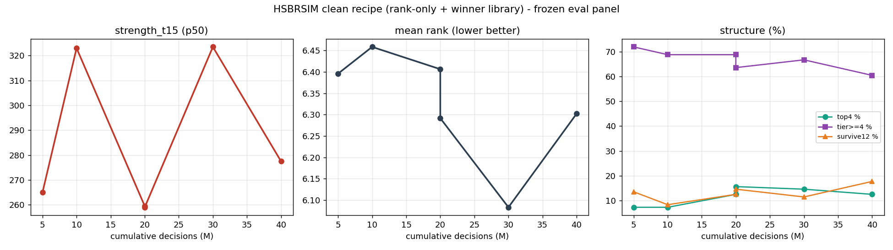

# 300M 曲线日志（干净配方：纯 rank-only + winner 库 + 无辅助头）

评测口径固定：`scripts/eval_panel.sh`（真实库 5 席 p0.9 / full fidelity / p75 / 96 局 / seed 520000）

| 累计M | 来源 | strength_t15 | mean_rank | top4 | tier>=4 | survive12 |
|---:|---|---:|---:|---:|---:|---:|
| 5 | s59_5m | 265.0 | 6.396 | 7.3% | 71.9% | 13.5% |
| 10 | s59_10m | 323.0 | 6.458 | 7.3% | 68.8% | 8.3% |
| 20 | s60b_10m | 259.5 | 6.406 | 12.5% | 68.8% | 12.5% |
| 20 | s61_10m | 259.0 | 6.292 | 15.6% | 63.5% | 14.6% |
| 30 | s61_20m | 323.5 | 6.083 | 14.6% | 66.7% | 11.5% |
| 40 | s72_10m | 277.5 | 6.302 | 12.5% | 60.4% | 17.7% |

## 结论（截至 40M）
- 强度在 259–323.5 区间震荡，最高出现在 **s61@30M（323.5）**；40M 时回落到 277.5（−14%，触发回退规则）。
- 名次最好出现在 **s61@30M（6.083）**；40M 回落到 6.302。
- survive12 从 11.5% 升到 17.7%：模型倾向“求生/稳名次”，盘面强度回落。
- 当前最佳 checkpoint：`runs/az_entity_s61/eval/ckpt_020026719.pt`。
- 与辅助奖励版对比：s55（含 tier-target）同口径 rank 6.458 / strength 305 ⇒ **干净配方在峰值上更优（323.5 vs 305）**。

